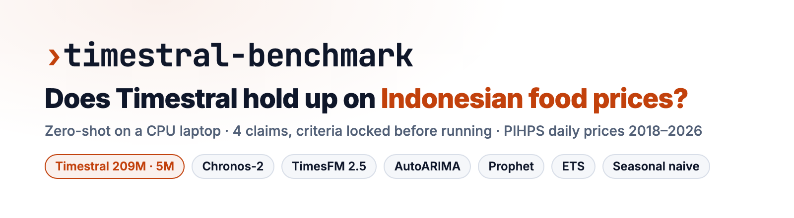
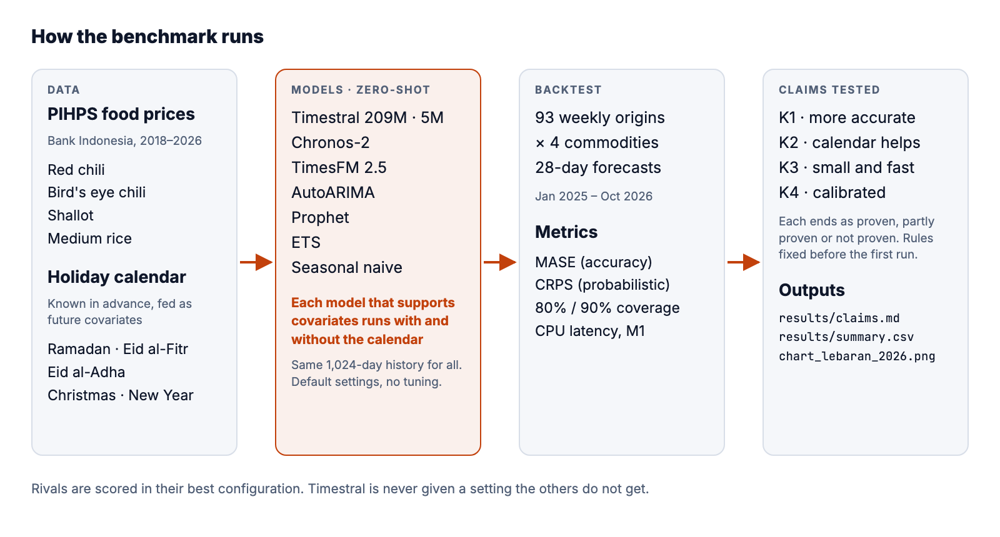
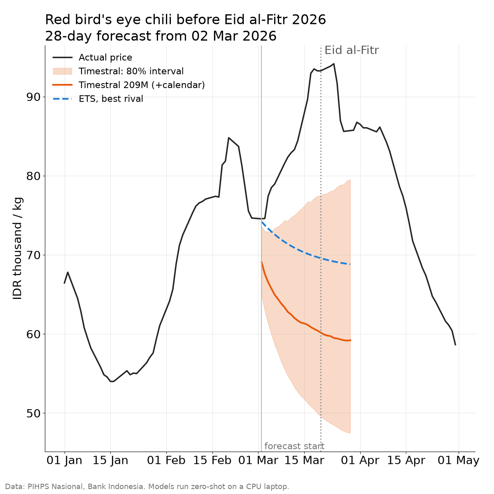

<div align="center">

<picture>
  <source media="(prefers-color-scheme: dark)" srcset="docs/assets/banner-dark.png">
  
</picture>

### An honest, reproducible benchmark of Timestral against other forecasting approaches on Indonesian daily food prices

**[Quick start ↓](#quick-start)** &nbsp;·&nbsp; **[Results ↓](#results)** &nbsp;·&nbsp; **[Methodology ↓](#methodology)** &nbsp;·&nbsp; **[Design spec →](docs/superpowers/specs/2026-11-09-timestral-pangan-design.md)**

[](pyproject.toml)
[](#methodology)
[](#data)

</div>

Timestral, Mistral's time-series foundation model released in October 2026, is reported to rank first on public forecasting leaderboards. It is also advertised as small enough to run on a CPU and as able to use calendar information that is known in advance. Leaderboards are built from public benchmark datasets, though, and teams forecasting Indonesian prices want to know something else: does the model still win on their own data, around Eid al-Fitr, when chili prices jump?

This repository answers that for four staple commodities, without taking sides:

- **Four claims, tested one by one.** Accuracy, the benefit of holiday covariates, small-model speed, and interval calibration. Each one ends as *proven*, *partly proven* or *not proven*.
- **Rules locked before the first run.** Pass and fail thresholds are written in the [design spec](docs/superpowers/specs/2026-11-09-timestral-pangan-design.md) and in `tsbench/claims.py`, with tests, before any result existed.
- **Fair to the rivals.** Every model gets the same history. Every model that supports covariates runs with and without them, and each rival is scored in its best configuration.
- **Runs on a laptop.** All models run zero-shot on a MacBook M1 with 8 GB RAM, with no GPU and no cost.

<picture>
  <source media="(prefers-color-scheme: dark)" srcset="docs/assets/architecture-dark.png">
  
</picture>

## Results

Run on 2026-11-09: 93 weekly origins × 4 commodities, 28-day forecasts, MacBook M1 (8 GB), CPU only.

| Claim | Verdict | Evidence |
|---|---|---|
| K1 | proven | relative MASE 0.778 vs best rival 0.834 (ets); relative CRPS 0.700 vs 0.735 (timesfm25) |
| K2 | not proven | with the calendar, Eid-window MASE 0.972 vs 0.885 without (9.8% worse); all origins 0.778 vs 0.795 (2.2% better) |
| K3 | proven | 5M vs 209M MASE +6.1%; 5M 93 ms per series, fastest: timestral_5m |
| K4 | proven | 80% interval covers 80.4%; 90% interval covers 91.6% |

**What this means**

- **Timestral-209M is the most accurate model on average.** Its 28-day MASE is 22% below seasonal naive and 7% below the best rival (AutoETS), and its CRPS (0.700) beats the best rival (TimesFM 2.5, 0.735).
- **Around Eid al-Fitr, no foundation model beats plain AutoETS (0.851).** The holiday calendar made Timestral *worse* in the Eid window (0.972 vs 0.885 without it), even though it helps slightly across the year. The chart below is that window: every model missed the run-up in chili prices.
- **The 21 MB model is good enough.** Timestral-5M is 6% behind the 209M, still ahead of every non-Timestral model on average, and the fastest at 93 ms per series on CPU. The 209M is the slowest of the four foundation models (1.6 s per series).
- **Timestral's intervals are honest.** Its 80% and 90% intervals cover 80% and 92% of actual prices. Chronos-2 (65%) and TimesFM 2.5 (70%) are overconfident, and Prophet (42%) much more so.



*Commodity and origin were chosen by fixed rules before looking at model results: the chili with the largest pre-Eid jump, and the last Monday at least 14 days before Eid al-Fitr 2026.*

<details>
<summary><b>Full leaderboard</b> (h=28, relative to seasonal naive, lower is better)</summary>

| Model | Calendar | MASE (all) | CRPS (all) | MASE (Eid window) | 80% cover | 90% cover |
|---|---|---|---|---|---|---|
| Timestral-209M | yes | 0.778 | 0.700 | 0.972 | 80% | 92% |
| Timestral-209M | no | 0.795 | 0.700 | 0.885 | 81% | 92% |
| Timestral-5M | no | 0.809 | 0.716 | 0.911 | 78% | 88% |
| Timestral-5M | yes | 0.825 | 0.725 | 1.043 | 75% | 87% |
| AutoETS | no | 0.834 | 0.856 | 0.851 | 82% | 90% |
| TimesFM 2.5 | no | 0.843 | 0.735 | 0.944 | 70% | – |
| AutoARIMA | no | 0.854 | 0.839 | 0.880 | 79% | 86% |
| AutoARIMA | yes | 0.879 | 0.847 | 0.880 | 79% | 86% |
| Chronos-2 | no | 0.967 | 0.850 | 1.113 | 65% | 79% |
| Seasonal naive | no | 1.000 | 1.000 | 1.000 | 79% | 87% |
| Chronos-2 | yes | 1.024 | 0.909 | 1.274 | 64% | 78% |
| TimesFM 2.5 | yes | 1.068 | 0.950 | 2.079 | 69% | – |
| Prophet | no | 2.130 | 1.879 | 2.168 | 42% | 52% |
| Prophet | yes | 2.232 | 1.972 | 2.333 | 38% | 48% |

</details>

<details>
<summary><b>CPU speed</b> (MacBook M1, median of 5 runs; one series = 1,024 days of history, 28-day forecast with calendar)</summary>

| Model | Weights | Load | Per series | 4 series |
|---|---|---|---|---|
| Timestral-5M | 21 MB | 2.5 s | 93 ms | 0.42 s |
| Timestral-209M | 837 MB | 3.5 s | 1626 ms | 6.57 s |
| Chronos-2 | 478 MB | 6.9 s | 490 ms | 1.95 s |
| TimesFM 2.5 | 925 MB | 5.9 s | 398 ms | 1.57 s |

</details>

**Sensitivity check, not used for the verdicts.** Following the spec, models that accept missing values received NaN on weekends. Chronos-2 does noticeably better with forward-filled input (MASE 0.847, CRPS 0.728), while Timestral does not change (0.794). Even then Chronos-2 stays behind Timestral-209M, so K1 does not change. See `results/sensitivity/summary.csv`.

## Quick start

**1. Install**

```bash
git clone https://github.com/anggaralabshq/timestral-benchmark.git && cd timestral-benchmark
uv sync
```

**2. Run the whole benchmark**

```bash
uv run python -m tsbench all
```

This downloads the PIHPS data, backtests every model, scores them, runs the CPU benchmark, judges the claims and draws the chart. Expect about an hour on an M1 laptop; Timestral-209M with the calendar (17 min) and ARIMAX (11 min) are the slowest steps.

**3. Read the verdict**

```bash
cat results/claims.md
open results/chart_lebaran_2026.png
```

## Install

Requirements: macOS or Linux, [uv](https://docs.astral.sh/uv/), and about 3 GB of disk for model weights. Python 3.12 is installed by uv.

```bash
uv sync                          # all dependencies, CPU builds
uv run pytest -m "not slow"      # fast tests
uv run pytest -m slow            # downloads the four foundation models and checks each adapter
```

## Usage

Each step can run on its own:

| Command | What it does |
|---|---|
| `python -m tsbench download` | Fetch PIHPS monthly files into `data/raw/` (cached; the current month is always refetched) |
| `python -m tsbench backtest --model NAME [--cov] [--jobs N]` | Rolling-origin backtest for one model, written to `results/forecasts/` |
| `python -m tsbench evaluate` | Per-origin metrics (`results/metrics.csv`) and the summary (`results/summary.csv`) |
| `python -m tsbench speed` | CPU load time and latency of the foundation models (`results/speed.csv`) |
| `python -m tsbench claims` | Claim verdicts (`results/claims.csv`, `results/claims.md`) |
| `python -m tsbench plot` | The headline chart (`results/chart_lebaran_2026.png`) |

Model names: `snaive`, `ets`, `arima`, `prophet`, `timestral_5m`, `timestral_209m`, `chronos2`, `timesfm25`. Run each foundation model in its own process to stay within 8 GB of RAM; `all` does this for you.

## Data

- **Source: PIHPS Nasional, Bank Indonesia.** Traditional-market prices, national average, working days, 2018-01-01 to 2026-11-09.
- Commodities: curly red chili (cabai merah keriting), red bird's eye chili (cabai rawit merah), medium shallot (bawang merah), medium-quality rice I (beras medium I).
- **This repository contains no data.** `python -m tsbench download` fetches it from PIHPS's public endpoint, which is undocumented and may change, with a one-second pause between requests. The data is copyright PIHPS / Bank Indonesia.

## Participants

| Model | Size | License | Covariates |
|---|---|---|---|
| Timestral-209M, Timestral-5M | 209M / 5M | Modified MIT ("2026 - Mistral AI"; companies above a revenue threshold need a commercial license) | yes, known-future |
| Chronos-2 | 120M | Apache 2.0 | yes |
| TimesFM 2.5 | 200M | Apache 2.0 (not 3.0, whose weights are non-commercial) | yes, via XReg |
| AutoARIMA / ARIMAX | – | statsforecast, Apache 2.0 | yes, exogenous |
| Prophet | – | MIT | yes, regressors + Indonesian holidays |
| AutoETS, seasonal naive | – | statsforecast, Apache 2.0 | no |

## Methodology

- **Rolling origin.** Every Monday from 2025-01-06 to 2026-10-12: 93 origins × 4 commodities. Each forecast covers 28 days. Results are reported at h=14 (mean over days 1–14) and h=28 (days 1–28).
- **Same history for every model.** The 1,024 calendar days before the origin. Days without a price are NaN; models that cannot take NaN get forward-filled input. Scoring uses only days with an actual price.
- **Calendar covariates, known in advance.** Days to the next Eid al-Fitr (capped at 60), a Ramadan flag, and ±7-day windows around Eid al-Fitr, Eid al-Adha, Christmas and New Year.
- **Metrics.** MASE (median against in-sample naive-1), CRPS (weighted quantile loss over the 0.1–0.9 quantiles), and 80% and 90% interval coverage. Headline scores are geometric means of the ratio to seasonal naive, so below 1 is better.
- **Eid window.** Origins from 45 days before Eid al-Fitr up to the day itself, for 2025 (31 March) and 2026 (20 March).
- **Fairness.** Rivals are compared in their best configuration, with or without covariates, chosen per score. Default settings from each model card, no tuning.

### Claim criteria

| Claim | Proven when |
|---|---|
| K1 Accuracy | Timestral-209M with covariates ranks first on both MASE and CRPS across all origins (h=28) |
| K2 Covariates | The calendar lowers Timestral's MASE by ≥5% in the Eid window and costs ≤2% elsewhere |
| K3 Small and fast | Timestral-5M is within 10% of the 209M's MASE and is the fastest foundation model per series on CPU |
| K4 Calibration | 80% intervals cover 75–85% of actual prices and 90% intervals cover 85–95% |

*Partly proven* and *not proven* are defined in [`tsbench/claims.py`](tsbench/claims.py) and the [spec](docs/superpowers/specs/2026-11-09-timestral-pangan-design.md).

## Limitations

- **Possible training-data overlap.** Timestral was pretrained on synthetic data, but its post-training used real data that is not named, with no stated cutoff (tech report, arXiv 2610.37585). Chronos-2 and TimesFM 2.5 were also trained on real corpora. None of the models can be ruled out as having seen PIHPS data.
- Islamic holiday dates come from Wikipedia because the Ministry of Religious Affairs site could not be fetched automatically. Eid al-Fitr 2026 may differ by one day from the official decision.
- National level and four commodities only. This is not a general claim about all time series.
- Speed is measured on one M1 laptop (median of five runs), one series at a time.

**Bug found and fixed during the run.** TimesFM 2.5 without covariates first scored 4.87× seasonal naive. The adapter read the first rows of TimesFM's output, which with `return_backcast=True` are the backcast (prices about three years old), not the forecast. It now reads the tail, a regression test covers it, and the TimesFM run was repeated before the verdicts above. TimesFM *with* covariates (XReg) was not affected; its weaker score is its own.

## Development

```text
tsbench/
  pihps.py      PIHPS scraper and parser
  series.py     daily series with NaN for missing days
  calendar.py   Indonesian holiday calendar and covariates
  models.py     one adapter per model, same contract
  metrics.py    MASE, CRPS (weighted quantile loss), coverage
  backtest.py   rolling-origin backtest, evaluation, summary
  claims.py     claim verdicts with the pre-registered rules
  speed.py      CPU benchmark
  plot.py       headline chart
docs/assets/remotion/   source for the README images (npm install && npm run render)
```

## License

The code license will be added before this repository goes public. Model weights and data keep their own licenses, listed above.
